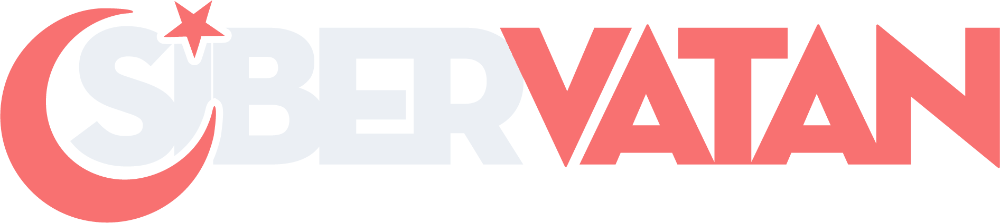

<!--
  Ümit Samet Taşçı — profile README
  Banner: assets/banner.svg  ·  Snake: .github/workflows/snake.yml
-->

<div align="center">
  
</div>

<div align="center">
  <a href="https://github.com/umitsTASCI">
    
  </a>
</div>

<div align="center">
  
  
  
  
  
</div>

<br/>

> **Computer Engineering student at Karabük University**, building where **security**, **robotics** and **software** meet. I like systems that have to survive the real world — networks under attack, robots in motion and apps in people's hands.

---

## 🧭 What I Work On

<table>
  <tr>
    <td width="50%" valign="top">
      <h3>🔐 Cybersecurity</h3>
      <p>Offensive security, network hardening and reverse engineering. I break systems on purpose in the lab so I can help build them stronger in production.</p>
    </td>
    <td width="50%" valign="top">
      <h3>🤖 Robotics Software</h3>
      <p>ROS 2 nodes, sensor pipelines and autonomous behaviour — from simulation to real hardware. Clean interfaces, predictable timing, no magic.</p>
    </td>
  </tr>
  <tr>
    <td width="50%" valign="top">
      <h3>⚙️ Systems &amp; Automation</h3>
      <p>Linux, scripting and small tools that remove repetitive work. If I do it twice, the third time is a script.</p>
    </td>
    <td width="50%" valign="top">
      <h3>📱 App Development</h3>
      <p>Mobile and desktop apps with a focus on clean architecture and usable interfaces — software that people actually enjoy opening.</p>
    </td>
  </tr>
</table>

---

## 🛠️ Tech Stack

**Languages**


**Security**


**Robotics & Autonomy**


**App Development**


**Tools**


---

## 🚀 Featured Projects

| Project | What it does | Built with |
| :--- | :--- | :--- |
| [**Aut0mat1c-Sn1ffer**](https://github.com/umitsTASCI/Aut0mat1c-Sn1ffer) | End-to-end lab automation: creates a PHP web shell, serves it locally and catches the reverse shell with Netcat. | `Shell` `Python` `Netcat` |
| [**wan-ip-remover**](https://github.com/umitsTASCI/wan-ip-remover) | Windows app that renews the ISP-assigned public IP on a schedule through a TP-Link TD-W9970. | `Python` `Networking` `Windows` |
| [**bypass**](https://github.com/umitsTASCI/bypass) | Containerized Xray + nginx tunnel with environment-driven config and a health endpoint. | `Docker` `Nginx` `Xray` |

<p align="right"><a href="https://github.com/umitsTASCI?tab=repositories"><b>All repositories →</b></a></p>

---

## 📊 GitHub Activity

<div align="center">
  
  
</div>

<div align="center">
  
</div>

<div align="center">
  
</div>

### 🐍 Contribution Snake

<picture>
  <source media="(prefers-color-scheme: dark)" srcset="https://raw.githubusercontent.com/umitsTASCI/umitsTASCI/output/github-contribution-grid-snake-dark.svg" />
  <source media="(prefers-color-scheme: light)" srcset="https://raw.githubusercontent.com/umitsTASCI/umitsTASCI/output/github-contribution-grid-snake.svg" />
  
</picture>

<p align="center"><sub>Refreshed daily by GitHub Actions — the snake eats my contribution graph.</sub></p>

---

## 🌱 Currently Exploring

- **ROS 2 & autonomy** — navigation stack, sensor fusion, simulation-to-real workflows
- **Embedded robotics** — microcontrollers, motor control and low-level sensor drivers
- **App architecture** — state management, offline-first data and clean UI systems
- **Offensive security** — exploit development, malware analysis and network fuzzing

---

## 🎓 Community & Training

<table>
  <tr>
    <td width="58%" valign="top">
      <p><b>Siber Vatan</b> — Türkiye's national cybersecurity program. Selected student, training on offensive and defensive security, network protocols and real-world lab scenarios.</p>
      <p><b>Karabük University</b> — Computer Engineering, Karabük / Türkiye.</p>
    </td>
    <td width="42%" valign="middle" align="center">
      
    </td>
  </tr>
</table>

---

## 🖤 Terminal

```bash
umit@kali:~$ whoami
Ümit Samet Taşçı · Cybersecurity & Robotics Software

umit@kali:~$ cat focus.txt
[security]  red team · network hardening · reverse engineering
[robotics]  ROS 2 · sensor pipelines · autonomous navigation
[apps]      mobile & desktop · clean UX · real users

umit@kali:~$ ros2 topic list
/scan  /odom  /cmd_vel  /camera/image_raw  /battery_state

umit@kali:~$ ./status.sh
[✓] learning   [✓] building   [✓] open to collaborate

umit@kali:~$ exit
```

---

## 🤝 Let's Connect

<div align="center">
  <a href="mailto:umitstasci@gmail.com"></a>
  <a href="https://linkedin.com/in/%C3%BCmit-samet-ta%C5%9F%C3%A7%C4%B1-bb409734a"></a>
  <a href="https://instagram.com/umt_tascii"></a>
  <a href="https://github.com/umitsTASCI"></a>
</div>

<p align="center">
  Open to <b>internships</b>, <b>junior security / robotics roles</b> and <b>open-source collaboration</b>.<br/>
  If you are building something at the edge of security, robotics or mobile — let's talk.
</p>

<div align="center">
  <sub>Build it. Break it. Understand it. Rebuild it better.</sub>
</div>
